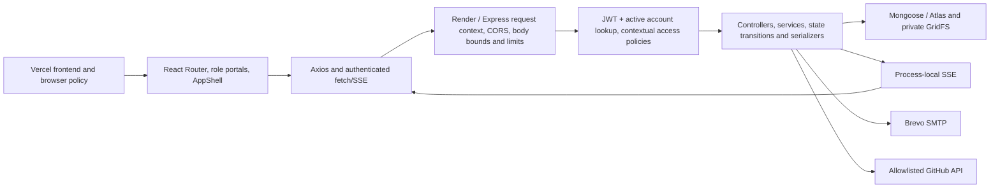

# TaskNexus V2 — Phase F1 system audit

Decision: **F1 PASS. Production readiness NO.** The evidence supports local remediation and measurement. A successful repository gate does not certify deployment, account recovery, backup, or provider behavior.

## Baseline and method

- Clean `main` at `d3a94e7619d9f1752e520426bfffa4c3489dc0d1`, equal to the local tracking ref and the GitHub main ref returned by a read-only lookup. This commit contains the previously uncommitted Phase E fixes. Initial staged/unstaged whitespace checks passed, and there were no untracked non-ignored files. F1 changed only this report.
- Traced entry points, routes, data boundaries, and selected end-to-end workflows. Ran existing regressions before touching source, with Node 24.22.1 locally and an isolated MongoDB 8.0 replica set bound to loopback with unique test databases and email disabled. The restored developer environment was outside the fixture target. Local evidence is distinct from historical documents and live evidence.
- The earlier Phase E container could not be inspected. Docker Desktop returned “manually paused” on an exact-name listing. No container or shared Docker resource was removed.

## System and trust boundaries

| Boundary | Owner and evidence |
|---|---|
| Browser and API | `frontend/src/App.jsx` owns routes. `ProtectedRoute.jsx` and `AuthContext.jsx` manage client navigation and bootstrap. `services/api.js` serializes token refresh per tab. AppShell provides search and notification state. Uploads and SSE use the API origin. Client guards do not grant permissions; backend authentication loads the active user and database role. |
| API input and identity | `backend/src/app.js` mounts public, auth, profile, marketplace, admin, team, project, discovery, hackathon, opportunity, organization, notification, search, and realtime routes. Request context and log middleware precede parsers. Express validation, service ownership predicates, and response serializers own input and output boundaries. |
| Global vs contextual roles | `middleware/auth.js` supplies active database identity. `teamAuthorization.js`, `projectAuthorization.js`, and `organizationAuthorization.js` resolve contextual permissions. Workspace access is distinct from catalog visibility. Native applicant access is scoped by role and organization; a platform admin does not implicitly receive organization applicant access. |
| Persistence | `models/index.js` declares 45 models. Unique records include task references, membership/ownership, submission versions, participation, evidence sources and applications. Session-backed writes are used for account+profile creation, work submission, member transitions and native application snapshots. Mongo connection readiness, pool and timeout settings are in `config/database.js`. Marketplace Task and ProjectTask have separate collections and lifecycle logic. |
| External systems | `render.yaml` declares a Node service and readiness check. Vercel config fixes the SPA origin, API destination and CSP hashes. GridFS streams private bytes behind app authorization. Nodemailer config and email templates are local-testable without SMTP. `githubProvider.js` constructs a fixed GitHub API host, disables redirects and sets a timeout. No real payment gateway is wired in the reviewed payment paths or dependencies. |

## Coverage and controls

- **Authentication.** Registration restricts role input, normalizes email and uses bcrypt through `userData.createUser`. The JWT module uses separate access/refresh keys and token types and a random refresh ID. Signing uses the library's default HS256, and verification uses its symmetric-key algorithm defaults without explicit issuer/audience checks. Production cookie requests have exact browser-origin enforcement and secure/HttpOnly cookie settings. One persisted digest per user means a new login replaces the refresh session. Auth routes expose register, login, refresh, logout and me. Reset/verification schema fields and templates do not establish a shipped recovery or email verification flow. Existing bearer access is expiry-based and account status is checked on regular requests. Full multi-device and deployed cookie behavior are unverified.
- **Authorization/privacy.** The local API, Mongo and Phase E verifiers exercise negative role and tenancy cases, public visibility, exact selected evidence and immutable submitted snapshots. The project roster exception is below. Export, deletion/retention and privacy requests are operator workflows in `PRIVACY_OPERATIONS.md`; an operator dry run and policy/legal approvals were outside F1. No compliance finding is inferred.
- **Marketplace/payment.** Acceptance and initial work submission have CAS/transaction coverage through `taskData.acceptTaskAtomically` and `submissionData.submitWorkAtomically`. Identified gaps in review and dispute handling below. Completion creates an internal escrow-labelled record. Admin changes internal release/refund flags. No provider charge, payout, reconciliation or currency conversion was verified. Commission and amount behavior in the current workflow must remain compatible; currency/rounding policy and migration need independent approval.
- **Queries.** List adapters have limits and stable secondary sorts in several domains. Dashboard overview and performance still pull historical tasks, payments, reviews and submissions into Node. Search fans out to seven services with a five-row cap and escaped substring terms. A five-row result does not bound how many candidate documents a query examines. Local API search was 23.8 ms median and 29.9 ms p95 over 20 warm requests. Large-candidate and concurrent measurements belong to F3.
- **Files/email.** The guarded GridFS verifier proved upload, reconnect, matching content hash, and cleanup; storage/authorization Jest checks passed. Multipart uses memory-backed inputs subject to request/file validation; wide concurrency and stream interruption were not measured. SMTP template/config passed with delivery disabled. No live sender, retry delivery, or restart recovery is certified. GitHub response parsing bounds content length and checks decoded byte length; provider fault coverage is local.
- **Realtime/abuse.** Notification mutations are recipient-scoped, and persisted list/unread counts remain authoritative. A single process holds stream maps and heartbeats; Auth checks at connection, with no shared delivery service. The global limiter skips the stream route. The hub does not act on write backpressure or recheck an already-open stream's access. Current rate limiter stores are process-local, with numeric proxy hops and IP-based limits. Multi-instance enforcement, topology, sustained connections and overload behavior require F3/manual evidence.
- **Frontend/config/observability.** AppShell, workspace, proof picker, an escaped text renderer and explicit target paths share frontend utilities. Existing tests cover stale search and notification reconciliation, onboarding and Phase E proof UI, but several wiring assertions are static and the review controller test mocks its writes. Backend request IDs, structured logs, liveness and Mongo-ready status exist. Production build validates canonical API and JSON-LD CSP hashes. No actual cloud headers, monitor delivery, retention drill or restore was contacted.

## Prioritized register

| ID and status | Evidence, mechanism and impact | Remediation, risk and required verification |
|---|---|---|
| F-SEC-001 · P1 · CONFIRMED · Security | `authController.refreshToken/logout` read and verify a digest, then `userData.updateUser` matches only the user ID. Concurrent requests can match the same old digest and overwrite a successor or revocation. A source trace establishes the missing atomic condition; an isolated concurrent regression will verify behavior. | Match active user and expected stored digest in a single conditional write. Preserve one-refresh-session behavior and cookie contract. Medium complexity, moderate race regression risk. Test concurrent rotation, stale cookie rejection, suspension and logout. |
| F-PRIV-001 · P1 · CONFIRMED · Privacy | Public `project.routes.js:36–48` calls `projectService.getProject` and `projectParticipantService.listParticipants`. Visibility grants project access and both paths serialize raw participant identifiers and roles. Public-only profile summaries mask profile fields but leave row identifiers; they do not enforce opt-in. This is outside the stricter showcase serializer. | Filter public roster at the backend and keep internal participant management intact. Medium complexity/risk. Verify opted-in public, opted-out public, private/inactive, team member and unrelated views, ID/slug/list parity and totals. |
| F-DATA-001 · P1 · CONFIRMED · Data | `clientController.reviewSubmission` checks then writes review, CAS-transitions the task, and inserts the internal payment in separate operations. A write error or competing decision can leave committed partial state; existing review coverage mocks every write. | Use one transaction with pending-active submission, owner and task-state predicates; create one internal payment only for accepted approval and publish events afterward. Medium complexity/high regression risk. Test conflicting reviews, rollback and revision limit without touching real money. |
| F-DATA-002 · P1 · CONFIRMED · Data | `adminController.resolveDispute` returns success and logs resolution with no payment, takes the first matching payment without checking ambiguity, and rewrites terminal states by ID. The conditional flags can also disagree and the refund shape is written for payouts. | Require a single eligible record and unambiguous resolution, conditional status update and atomic audit; preserve existing payment semantics. Medium complexity. Test missing/ambiguous rows, conflicting decisions, terminal state and no extra audit on failure. |
| F-SUP-001 · P1 · CONFIRMED · Supply chain | Registry audit found backend 1 critical, 2 high and 3 moderate package entries (Express/body-parser/proxy-addr/qs, Mongoose 9.9.4 and Nodemailer 10.0.14). Frontend had one high package entry, follow-redirects 1.16.0 through Axios. Affected versions are confirmed; production exploitability is not established. Express uses numeric proxy hops and the browser builds use browser transport. | Prefer patched compatible releases or narrow overrides. Medium risk, require clean install, both production audits, auth, parsing, database and email regressions, and build. [Mongoose advisory](https://github.com/advisories/GHSA-8332-j7wj-wjw4) · [proxy-addr advisory](https://github.com/advisories/GHSA-jqcg-44mw-7w3h) · [follow-redirects advisory](https://github.com/advisories/GHSA-mrwp-f3q8-3g9p). |
| F-PERF-001 · P2 · CONFIRMED · Performance | Both `getDashboard` handlers retrieve full role-owned tasks/payments, plus reviews on freelancer; the performance service fetches tasks/submissions again. It also rewrites the entire freelancer profile on an overview read. Cost grows with owner history despite five visible rows. | Measure 100/1,000/10,000 cases. Prefer projections, database summaries or cursor batches with exact onboarding, time and money parity. Medium/high risk. Verify empty, mixed statuses and payment states, date/rounding parity and role isolation. |
| F-REL-001 · P2 · CONFIRMED · Reliability | `realtimeHub` maintains per-process user/role maps and writes without handling backpressure. It authenticates at connect only. Cross-instance delivery is not proven. `performanceService` may emit arbitrary fallback values on failure. | Measure lifecycle and slow-stream behavior; preserve persistent-read recovery and define any metric fallback from product requirements. Use bounded tests and no new event system. |
| F-OPS-001 · P2 · CONFIRMED · Operations | `package.json`'s verify chain omits frontend tests. Two workflow jobs overlap; only one runs production dependency audits. `verifyScaleIntegration.js` drops a fixed name on the effective host and overwrites committed evidence. `verify:launch` checks that historical artifact, not a fresh workload. | Wire the frontend suite into the existing gate. Treat legacy scale output as historical and use isolated, narrowly scoped fixture cleanup for fresh evidence. Test refusal of non-loopback and stale artifacts separately if changing the legacy tool. |
| F-OPS-002 · P3 · CONFIRMED · Documentation | `PRODUCT_COHESION.md` still says Phase E is unimplemented below its acceptance record. | Correct the footer during F4 documentation. |
| F-EXT-001 · release blocker · UNVERIFIED | Exposure history identifies MongoDB, SMTP, and JWT credential classes. Repo contains a rotation procedure but no completion receipt for those values. The secret scan examines source and cannot certify revocation. | Owner rotates with separate authorization, verifies old credential rejection and reviews access. New JWT signing keys invalidate existing access and refresh tokens, so plan a coordinated sign-in window and revoke stale refresh digests if approved. Use sanitized receipts only. |
| F-EXT-002 · release blocker · UNVERIFIED | `LAUNCH_BLOCKERS.md`, `BACKUP_RESTORE.md`, and deployment configuration describe intended operations and historical observations. Cloud dashboards and current production were outside scope. | Require independent Atlas backup/PITR and isolated restore evidence, hosted revisions/branch protection, HTTPS/cookie/CSP/GridFS smoke, monitors/test alerts, named on-call/privacy roles, and a documented rollback target. |

## Fresh verification and next gates

| Check | Result |
|---|---|
| `npm run verify:launch` | PASS. Backend 49 suites / 384 tests; backend/frontend lint, Vite build, frontend config, seven backend production checks, four launch contract checks and source scan (463 files). Build warned about an approximately 615 kB entry chunk. |
| `node --test frontend/tests/*.test.js` | PASS, 50 tests. |
| Mongo/API integration, Phase E, GridFS | PASS on disposable loopback Mongo. API fixture includes Team/Project and privacy and notification operations. Phase E verified query bounds, canonical overlap, IDOR, explicit evidence and immutable snapshots. |
| Email config/templates | PASS without SMTP. |
| Production dependency audit | FAIL in both packages at baseline; see F-SUP-001. |
| Complete combined browser journeys and 100/1,000/10,000 dashboard scale | Pending F3/F4. Prior Phase E documentation is historical. |
| Live cloud controls, provider credentials and recovery | NOT VERIFIED; external action required. |

F1 register totals: 0 confirmed P0, 5 confirmed P1, 3 confirmed P2, 1 confirmed P3, and 2 grouped external blockers. F2 addresses confirmed code risks with red/green tests. F3 measures the same fixtures before and after narrow optimizations. F4 verifies repository release controls, runs the local golden paths and records independent production no-go items. No hosted actions or payments are authorized.

Follow-up finding F-DATA-003 (P1, Data, CONFIRMED) was found during F4 golden-path verification and routed back through F2. `freelancerController.updateSubmission` replaced the current version in place while revision limits count records of type `revision`. A synthetic create-to-revision journey observed one record after resubmission instead of two. Version append and task/notification/audit atomicity were the minimal retention-safe fix. Main risks were changed active IDs and drift in allowed actions. Verified with competing resubmissions, retained original content, rejected over-limit revision and final approval. The clients use the new active ID from their existing refresh path. No historical records were rewritten.
